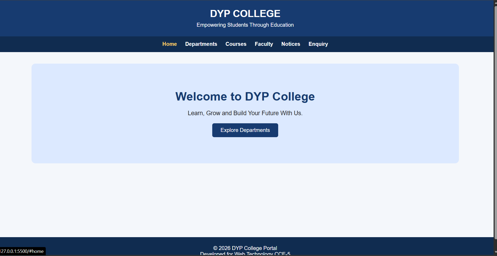
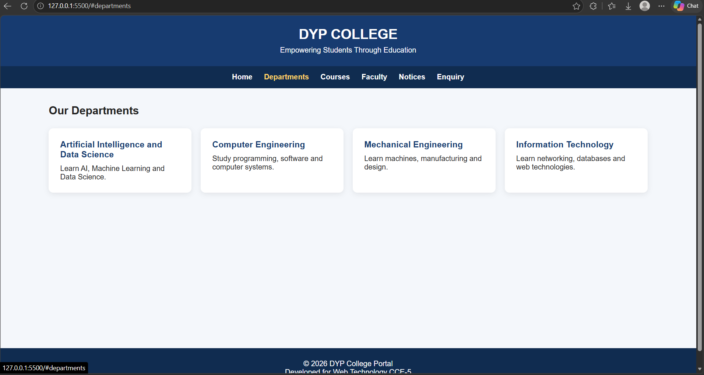
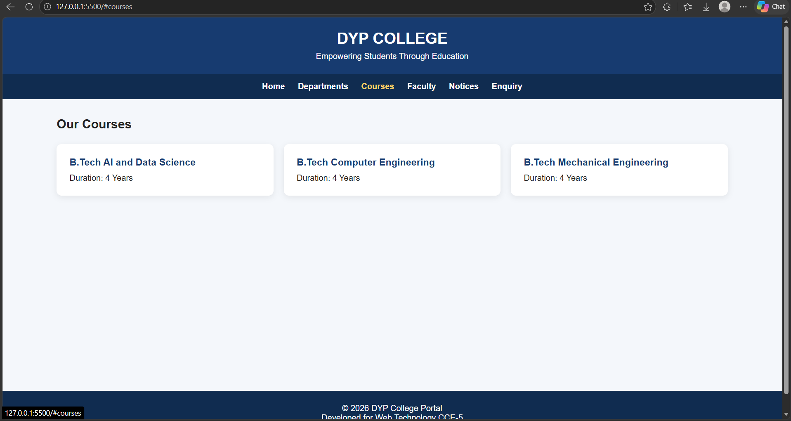
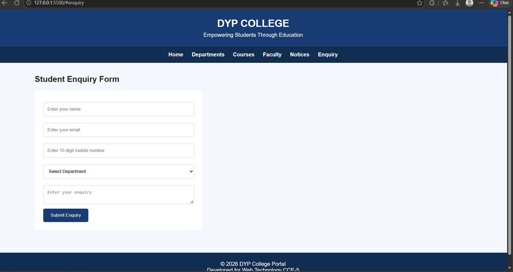

# WT_CCE5_229_SmartCollegePortal

# Smart College Website Portal

## Project Information
- Subject: Web Technology 1
- CCE: 5
- Student: Damini Kotnake
- Roll Number: 229
- Batch: WT C1

## Project Description
Smart College Website Portal is a responsive website
that provides information about college departments,
courses, faculty and notices.

It also provides a student enquiry form.

## Technologies Used
- HTML
- CSS
- JavaScript
- JSON

## Features
1. Home Page
2. Departments
3. Courses
4. Faculty
5. Notices
6. Enquiry Form
7. SPA Navigation
8. Responsive Design
9. JSON Data Loading
10. Form Validation

## Project Screenshots

### 1. Home Page

### 2. Departments

### 3. Courses

### 4. Enquiry Form

## How to Run
1. Download the project.
2. Open the folder in VS Code.
3. Install Live Server.
4. Right-click index.html.
5. Select Open with Live Server.

## Conclusion
This project demonstrates the development of
a responsive Single Page Application using
HTML, CSS and JavaScript.
